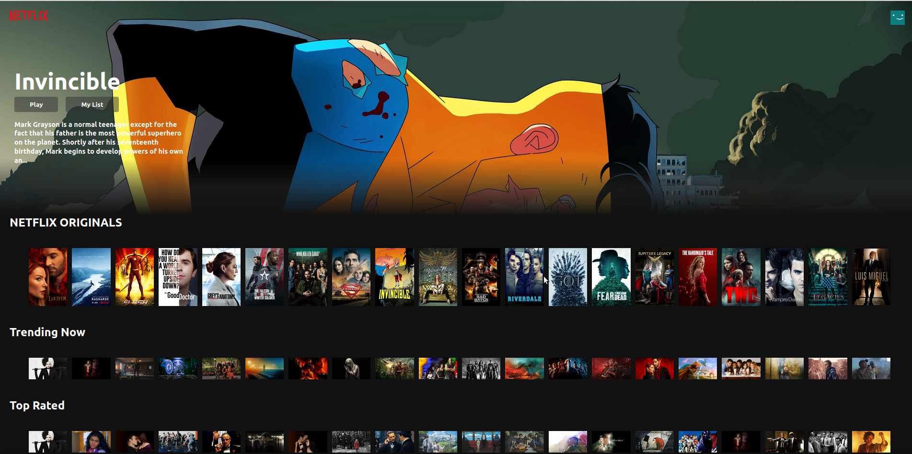

# StreamFlix - Movie & Series Catalog

Web interface inspired by Netflix built with React and the TMDB API to browse movies and TV series organized by genre.



## Features

- Featured hero banner with dynamic movie backdrop and overview
- Horizontal carousels categorized by Trending, Top Rated, Action, Comedy, Horror, and Documentaries
- Interactive movie poster selection with YouTube trailer playback
- Responsive layout styled with custom CSS3

## Tech Stack

- React
- JavaScript (ES6+)
- Axios
- TMDB REST API
- CSS3

## Getting Started

1. Clone the repository:
```bash
git clone https://github.com/davyd9/streamflix-react-web.git
cd streamflix-react-web
```

2. Copy the environment variable template and add your TMDB API key:
```bash
cp .env.example .env
```

3. Install dependencies and start the development server:
```bash
npm install
npm start
```
